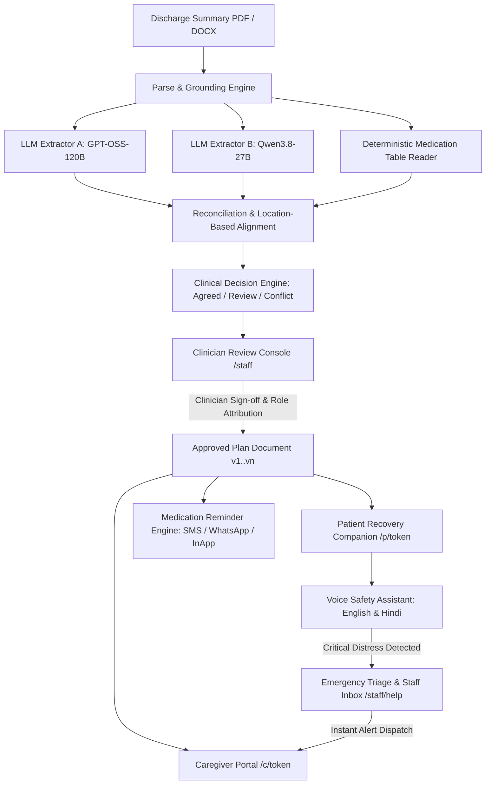

# RecoverRight

> **Safe, Auditable, Clinician-Approved Discharge-to-Home Recovery Platform**

RecoverRight converts complex, unstructured clinical discharge summaries (PDF, DOCX) into evidence-grounded, clinician-approved recovery plans. It coordinates daily patient recovery tasks, medication schedules, family caregiver oversight, continuous voice safety assistance with distress escalation, and immutable clinical audit trails.

---

## 🏥 Architecture Overview

RecoverRight operates across four integrated layers:



### 1. Dual Extraction & Deterministic Table Grounding
- **Dual Extractor Pipeline**: Runs two independent LLM models (`MODEL_A` and `MODEL_B`) in parallel to extract medications, wound care instructions, dietary restrictions, warning signs, and follow-up appointments.
- **Deterministic Medication Table Reader**: Extracts drug tables directly from document layout without LLM hallucination risk.
- **Location-Based Reconciliation**: Aligns entities by source paragraph and character offset rather than fuzzy string matching.
- **Zero Hallucination Guardrail**: Fields with model disagreement or missing source quotes are flagged as blockers (`needs_review` or `conflict`), preventing discharge approval until reviewed by a clinician.

### 2. Clinician Review & Approval Console (`/staff`)
- Field-by-field review with exact source quote highlighting.
- Role-based clinician approval (`Doctor`, `Nurse`, `Pharmacist`) with immutable attribution.
- Versioned plan unlocks: allows safe modifications post-approval (`v1 -> v2`) while preserving history.
- Adherence monitoring: tracks task completion, missed doses, and patient recovery milestones.

### 3. Patient Recovery Companion (`/p/{token}`) & Caregiver Portal (`/c/{token}`)
- Secure patient link token access without passwords.
- Daily recovery tasks with instant completion and snooze support.
- Medication schedule tracking with dose self-reporting.
- Consented caregiver portal with granular privacy boundaries and multi-channel safety alerts (SMS, WhatsApp).

### 4. Voice Assistant & Emergency Escalation
- Real-time bilingual speech recognition supporting Indian English (`en-IN`) and Hindi (`hi-IN`).
- Eager distress detection with local negation analysis ("no pain but can't breathe" triggers immediate critical alert).
- Clinical emergency SLA queue (120s for critical, 600s for concern) in `/staff/help`.

---

## 🚀 Quickstart

### Option A: Docker Compose (Recommended)

1. **Clone the repository and prepare environment variables**:
   ```bash
   cp .env.example .env
   # Edit .env with your GROQ_API_KEY if testing live LLM extraction
   ```

2. **Launch the stack**:
   ```bash
   docker-compose up --build
   ```

3. **Access Services**:
   - Web Application: [http://localhost:3000](http://localhost:3000)
   - Staff Console: [http://localhost:3000/staff](http://localhost:3000/staff)
   - Live Pipeline Theater: [http://localhost:3000/live](http://localhost:3000/live)
   - Patient Demo: [http://localhost:3000/p/demo](http://localhost:3000/p/demo)
   - Caregiver Demo: [http://localhost:3000/c/demo](http://localhost:3000/c/demo)
   - API Docs: [http://localhost:8000/docs](http://localhost:8000/docs)
   - Health Probe: [http://localhost:8000/health](http://localhost:8000/health)

---

### Option B: Local Development

#### Prerequisites
- Python 3.11+
- Node.js 20+

#### 1. Backend Setup
```bash
cd api
python -m venv .venv
# On Windows: .venv\Scripts\activate
# On Linux/macOS: source .venv/bin/activate
pip install -r requirements.txt
uvicorn app.main:app --reload --port 8000
```

#### 2. Frontend Setup
```bash
cd web
npm install
npm run dev
```

#### 3. Automated One-Command Launch
- **Windows**: `.\start.ps1`
- **Linux / macOS**: `./start.sh`

---

## 🔒 Security, Auditing & Compliance

- **Zero Secret Leakage**: The automated compliance verifier ensures API keys, tokens, and credentials are never logged to disk.
- **Immutable Clinical Audit Trail**: Every clinical action (upload, review, approval, revision, reminder delivery, dose report, emergency call) is appended to `audit.jsonl` with UTC timestamp and actor attribution.
- **Request Tracing & Security Headers**: Injects `X-Request-ID` correlation tracking, process latency, CSP, HSTS, and frame protection on all HTTP responses.
- **Redundancy & Probes**: Liveness (`/health`), Readiness (`/ready`), and Operational Metrics (`/system/metrics`) endpoints for Kubernetes and container monitoring.

---

## 🧪 Verification & Test Suite

RecoverRight includes full automated test coverage across both API and Web layers:

```bash
# 1. Operational Hardening & Audit Verification
python -m unittest discover -s tests -p "test_phase8*.py" -t .
python -m scripts.verify_audit

# 2. Pipeline Reconciliation & Document Ingestion Checks
python -m scripts.test_reconcile
python -m scripts.test_pipeline
python -m scripts.test_api

# 3. Full Backend Regression
python -m unittest discover -s tests -t .

# 4. Web TypeScript Check & Test Runner
cd ../web
npx tsc --noEmit
npx tsx --test tests/*.test.ts
```

---

## 📄 License

Proprietary and confidential. Developed for clinical recovery workflows.
